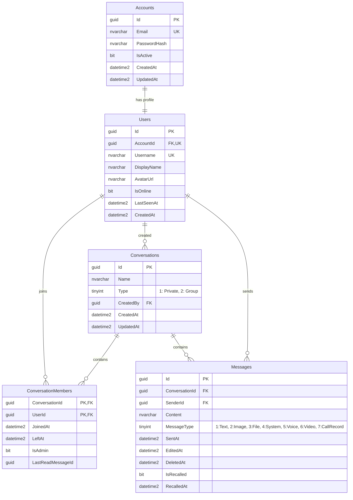

# 💬 MessageZ - Realtime Chat & WebRTC Communication Platform

<p align="center">
  
  
  
  
  
  
</p>

---

## 📖 1. Giới thiệu & Mô tả dự án (Overview)

**MessageZ** là hệ thống nền tảng nhắn tin và truyền thông thời gian thực (Real-time Chat & WebRTC Calling System). Dự án được thiết kế theo kiến trúc phân tầng chuyên nghiệp (**Clean/Layered Architecture**) kết hợp **Repository & Unit of Work Pattern**, đảm bảo tính mở rộng, bảo mật và hiệu năng cao.

Hệ thống cho phép người dùng trò chuyện trực tiếp 1-1, tạo và quản lý nhóm chat, chia sẻ tin nhắn đa phương tiện (ảnh, tệp tin, ghi âm giọng nói, video clip) và thực hiện các cuộc gọi thoại / video trực tiếp độ trễ thấp thông qua giao thức WebRTC với SignalR Hub đóng vai trò máy chủ định tuyến tín hiệu (Signaling Server).

---

## 🛠️ 2. Công nghệ sử dụng (Tech Stack)

### Backend & Frameworks
- **Ngôn ngữ & Runtime**: C# 12, [.NET 8](https://dotnet.microsoft.com/download/dotnet/8.0) (ASP.NET Core Web API).
- **ORM & Database Access**: [Entity Framework Core 8](https://learn.microsoft.com/ef/core/) (Code-First / DbContext mapping).
- **Cơ sở dữ liệu**: Microsoft SQL Server.
- **Thời gian thực (Real-time Messaging)**: [ASP.NET Core SignalR](https://learn.microsoft.com/aspnet/core/signalr/introduction) (WebSocket, Server-Sent Events, Long Polling fallback).
- **Gọi thoại & Video (P2P Calling)**: [WebRTC](https://webrtc.org/) Signaling thông qua SignalR Hub.

### Bảo mật & Xác thực (Security & Auth)
- **JSON Web Tokens (JWT)**: `Microsoft.AspNetCore.Authentication.JwtBearer` với cơ chế xác thực kép (HTTP Authorization Header và Query String `access_token` cho SignalR WebSocket).
- **Password Hashing**: `BCrypt.Net-Next` giúp mã hóa và băm mật khẩu chuẩn công nghiệp an toàn chống tấn công Rainbow table.
- **CORS**: Cấu hình mở rộng hỗ trợ xác thực thông tin đăng nhập và đa nguồn gốc linh hoạt (`AllowCredentials`).

### Lưu trữ & Tối ưu hóa đa phương tiện
- **Cloud Storage**: [Cloudinary](https://cloudinary.com/) (`CloudinaryDotNet 1.29.3`) dùng để lưu trữ đám mây cho ảnh đại diện, ảnh tin nhắn, tài liệu đính kèm, voice note và video.
- **Dọn dẹp tự động**: Tự động xóa file media cũ trên Cloudinary khi cập nhật ảnh đại diện hoặc khi người dùng thu hồi tin nhắn.

### Thư viện & Công cụ phụ trợ
- **AutoMapper 16.2.0**: Ánh xạ tự động giữa Entities và DTOs.
- **Swashbuckle.AspNetCore 6.6.2 (Swagger / OpenAPI)**: Tài liệu hóa và kiểm thử API tương tác trực quan.
- **Microsoft.AspNetCore.OData 9.2.1**: Hỗ trợ truy vấn dữ liệu linh hoạt.

---

## 🚀 3. Tính năng & Chức năng chi tiết (Key Features)

### 3.1. Xác thực & Quản lý tài khoản (Authentication)
- **Đăng ký tài khoản (`/api/auth/register`)**: Kiểm tra ràng buộc hợp lệ (Email, Username không trùng lặp, độ dài mật khẩu), tự động băm mật khẩu bằng BCrypt và khởi tạo hồ sơ người dùng.
- **Đăng nhập (`/api/auth/login`)**: Xác thực tài khoản, kiểm tra trạng thái kích hoạt (`IsActive`) và cấp JWT Bearer Token chứa User Identifier và thông tin phiên làm việc.

### 3.2. Quản lý hồ sơ & Người dùng (User Profile & Presence)
- **Thông tin cá nhân**: Xem và cập nhật tên hiển thị (`DisplayName`), email, thời gian khởi tạo.
- **Ảnh đại diện (Avatar)**: Tải lên hình ảnh lên thư mục Cloudinary `messagez/avatars`, tự động xóa avatar cũ trên Cloud khi thay mới.
- **Tìm kiếm bạn bè / người dùng**: Tìm kiếm theo Username hoặc Tên hiển thị phục vụ tạo cuộc trò chuyện mới.
- **Trạng thái trực tuyến (User Presence Tracking)**:
  - Tự động phát hiện khi người dùng kết nối hoặc ngắt kết nối qua SignalR (`InMemoryPresenceTracker`).
  - Broadcast sự kiện `UserPresenceChanged` tới toàn bộ người dùng khác ngay tức thì.
  - Lưu lại mốc thời gian hoạt động gần nhất (`LastSeenAt`).

### 3.3. Nhắn tin 1-1 & Nhóm trò chuyện (Chat System)
- **Cuộc trò chuyện 1-1 (Direct Message)**:
  - Khởi tạo hoặc tái sử dụng phòng chat riêng giữa 2 người dùng.
  - Tự động lấy tên hiển thị và avatar của đối phương để hiển thị trong danh sách hội thoại.
- **Quản lý nhóm chat (Group Chat Management)**:
  - Tạo nhóm với danh sách thành viên ban đầu và tự động bổ nhiệm người tạo làm Quản trị viên (`IsAdmin = true`).
  - **Thêm thành viên**: Thêm nhiều thành viên cùng lúc, hỗ trợ kích hoạt lại thành viên cũ từng rời nhóm.
  - **Xóa thành viên**: Quyền dành cho Admin để loại bỏ thành viên khỏi nhóm.
  - **Rời nhóm**: Thành viên chủ động rời nhóm; nếu Admin duy nhất rời đi, quyền Admin sẽ tự động chuyển giao cho thành viên gia nhập sớm nhất còn lại.
  - **Đổi tên nhóm**: Cập nhật tên nhóm thời gian thực và ghi nhận tin nhắn thông báo hệ thống.
- **Đánh dấu đã đọc (`Mark as Read`)**: Theo dõi vị trí tin nhắn đọc cuối cùng (`LastReadMessageId`) và tính toán chính xác số lượng tin nhắn chưa đọc (`UnreadCount`) cho mỗi thành viên.

### 3.4. Tin nhắn đa định dạng phong phú (Rich Media Messaging)
Hệ thống phân loại tin nhắn qua thuộc tính `MessageType`:
1. **Tin nhắn văn bản (Text - Type 1)**: Trao đổi nội dung tin nhắn tức thời qua SignalR.
2. **Hình ảnh (Image - Type 2)**: Tải ảnh qua API multipart/form-data, lưu trữ trên Cloudinary và gửi đường dẫn kèm kích thước.
3. **Tệp đính kèm (File / Attachment - Type 3)**: Hỗ trợ đính kèm tệp tài liệu, nén... lưu trữ Cloudinary, lưu kèm metadata (tên file, dung lượng, định dạng).
4. **Tin nhắn hệ thống (System - Type 4)**: Tự động ghi lại các biến động trong nhóm (tạo nhóm, thêm người, đổi tên, rời nhóm).
5. **Tin nhắn thoại (Voice Note - Type 5)**: Thu âm giọng nói, tải lên Cloudinary định dạng âm thanh kèm thời lượng phát (duration).
6. **Video clip ngắn (Video - Type 6)**: Cho phép gửi video ngắn (giới hạn tối đa 60 giây), tự động tạo thumbnail trên Cloudinary.
7. **Lịch sử cuộc gọi (Call Record - Type 7)**: Bản ghi lưu lại lịch sử cuộc gọi (loại cuộc gọi thoại/video, trạng thái: Thành công / Cuộc gọi nhỡ / Bị từ chối, thời lượng đàm thoại).

### 3.5. Thu hồi tin nhắn thông minh (Message Recall)
- **Quyền hạn**: Chỉ người gửi tin nhắn mới có quyền thu hồi.
- **Giới hạn thời gian**: Chỉ được phép thu hồi tin nhắn trong vòng **5 giờ** kể từ lúc gửi.
- **Dọn dẹp Cloudinary**: Đối với tin nhắn Media (ảnh, file, voice, video), hệ thống tự động xóa dữ liệu vật lý trên Cloudinary để giải phóng tài nguyên và bảo vệ quyền riêng tư.
- **Bảo toàn dữ liệu**: Giữ lại bản ghi trong CSDL với cờ `IsRecalled = true`, `RecalledAt` và thay thế nội dung thành *"This message has been recalled"*.
- **Thời gian thực**: Gửi sự kiện `MessageRecalled` và cập nhật preview tin nhắn gần nhất tới tất cả thành viên trong nhóm tức thì.

### 3.6. Cuộc gọi thoại & Video thời gian thực (WebRTC Signaling)
SignalR Hub (`ChatHub`) hoạt động như một máy chủ chuyển tiếp tín hiệu (Signaling Server) hỗ trợ kết nối P2P WebRTC:
- `CallUser`: Khởi tạo cuộc gọi (Voice/Video) và bắn sự kiện `IncomingCall` tới người nhận kèm thông tin người gọi.
- `AnswerCall`: Chấp nhận hoặc từ chối cuộc gọi, kích hoạt sự kiện `CallAnswered`.
- `SendSignal`: Trao đổi dữ liệu phiên WebRTC (SDP Offers, Answers, ICE Candidates) qua sự kiện `ReceiveSignal`.
- `EndCall`: Kết thúc cuộc gọi và thông báo `CallEnded`.
- `RecordCall`: Tự động đồng bộ thời lượng và kết quả cuộc gọi thành một tin nhắn lưu trữ trong đoạn chat.

---

## 📂 4. Cấu trúc thư mục Backend (Project Structure)

```text
MessageZ/
├── MessageZ/
│   ├── WebAPI/                             # ASP.NET Core Web API Backend
│   │   ├── Controllers/                    # API Endpoints
│   │   │   ├── AuthController.cs           # Đăng ký, Đăng nhập
│   │   │   ├── UserController.cs           # Profile, Avatar, Tìm kiếm User
│   │   │   └── ConversationController.cs   # Quản lý Chat, Tin nhắn, Media, Nhóm
│   │   ├── DTOs/                           # Data Transfer Objects
│   │   │   ├── Auth/                       # DTO Đăng ký, Đăng nhập
│   │   │   ├── Conversation/               # DTO Hội thoại, Thành viên, Nhóm
│   │   │   ├── Message/                    # DTO Tin nhắn văn bản, Tệp, Voice, Video
│   │   │   └── User/                       # DTO Hồ sơ người dùng
│   │   ├── Hubs/                           # SignalR Hubs & Providers
│   │   │   ├── ChatHub.cs                  # Hub chat thời gian thực, WebRTC Signaling
│   │   │   └── CustomUserIdProvider.cs     # Ánh xạ kết nối SignalR với UserId từ JWT
│   │   ├── Models/                         # Database Entities & Context
│   │   │   ├── Account.cs                  # Bảng tài khoản & thông tin đăng nhập
│   │   │   ├── User.cs                     # Bảng thông tin người dùng
│   │   │   ├── Conversation.cs             # Bảng phòng trò chuyện
│   │   │   ├── ConversationMember.cs       # Bảng liên kết thành viên & quyền hạn
│   │   │   ├── Message.cs                  # Bảng tin nhắn & trạng thái thu hồi
│   │   │   └── RealtimeChatDbContext.cs    # EF Core DbContext
│   │   ├── Repositories/                   # Lớp truy xuất dữ liệu (Data Access Layer)
│   │   │   ├── IConversationRepository.cs
│   │   │   ├── IUserRepository.cs
│   │   │   ├── IAccountRepository.cs
│   │   │   ├── IUnitOfWork.cs
│   │   │   └── Implements/
│   │   ├── Services/                       # Lớp xử lý nghiệp vụ (Business Logic Layer)
│   │   │   ├── IAuthService.cs             # Dịch vụ xác thực & cấp phát JWT
│   │   │   ├── IConversationService.cs     # Nghiệp vụ chat, tin nhắn, thu hồi, nhóm
│   │   │   ├── IPhotoService.cs            # Tải lên & xóa ảnh đại diện Cloudinary
│   │   │   ├── IFileService.cs             # Xử lý tệp đính kèm, voice, video trên Cloud
│   │   │   ├── IUserPresenceTracker.cs     # Quản lý trạng thái trực tuyến
│   │   │   └── Implements/
│   │   ├── Mappers/                        # AutoMapper Profiles
│   │   ├── appsettings.json                # Cấu hình chuỗi kết nối, JWT, Cloudinary
│   │   └── Program.cs                      # Cấu hình DI, Middleware, Pipeline
│   │
│   ├── WebMVC/                             # Giao diện người dùng (ASP.NET Core MVC Client)
│   └── MessageZ.sln                        # Visual Studio Solution File
│
├── db.sql                                  # Kịch bản khởi tạo CSDL SQL Server
└── README.md                               # Tài liệu dự án
```

---

## 🗄️ 5. Lược đồ cơ sở dữ liệu (Database Schema)

Cơ sở dữ liệu **`RealtimeChatDb`** bao gồm 5 bảng chính được thiết kế tối ưu với khóa ngoại và chỉ mục (Indexes):



---

## ⚡ 6. Hướng dẫn cài đặt & Chạy ứng dụng (Getting Started)

### Yêu cầu tiên quyết
- Cài đặt [.NET 8 SDK](https://dotnet.microsoft.com/download/dotnet/8.0).
- Cài đặt [Microsoft SQL Server](https://www.microsoft.com/sql-server) (hoặc SQL Express / Docker container).
- Tài khoản miễn phí trên [Cloudinary](https://cloudinary.com/) để lấy thông tin kết nối API.

### Bước 1: Khởi tạo Cơ sở dữ liệu
1. Mở SQL Server Management Studio (SSMS) hoặc Azure Data Studio.
2. Mở file [db.sql](file:///e:/MessageZ/db.sql) ở thư mục gốc của dự án.
3. Chạy script để tạo database `RealtimeChatDb` cùng toàn bộ bảng, khóa chính, khóa ngoại và indexes.

### Bước 2: Cấu hình `appsettings.json`
Mở file [appsettings.json](file:///e:/MessageZ/MessageZ/WebAPI/appsettings.json) trong thư mục `MessageZ/WebAPI/` và cập nhật thông số của bạn:

```json
{
  "ConnectionStrings": {
    "DefaultConnection": "Server=YOUR_SERVER;Database=RealtimeChatDb;User Id=sa;Password=YOUR_PASSWORD;TrustServerCertificate=True;Encrypt=False;"
  },
  "Jwt": {
    "Key": "YourSuperSecretKeyWithLengthAtLeast32CharactersHere!",
    "Issuer": "MessageZ",
    "Audience": "MessageZ"
  },
  "Cloudinary": {
    "URL": "CLOUDINARY_URL=cloudinary://<API_KEY>:<API_SECRET>@<CLOUD_NAME>"
  }
}
```

### Bước 3: Build và Chạy WebAPI
Mở terminal tại thư mục backend:

```bash
cd MessageZ/WebAPI
dotnet restore
dotnet build
dotnet run
```

Sau khi khởi chạy thành công:
- **API Swagger Documentation**: `https://localhost:<port>/swagger`
- **SignalR Hub Endpoint**: `https://localhost:<port>/chatHub`

---

## 📡 7. Danh sách API chính (API Endpoints Overview)

| Phân hệ | Phương thức | Endpoint | Mô tả |
| :--- | :--- | :--- | :--- |
| **Auth** | `POST` | `/api/auth/register` | Đăng ký tài khoản mới |
| | `POST` | `/api/auth/login` | Đăng nhập và nhận JWT Bearer Token |
| **User** | `GET` | `/api/user` | Tìm kiếm danh sách người dùng (`?query=...`) |
| | `GET` | `/api/user/profile` | Xem thông tin cá nhân của người dùng hiện tại |
| | `PUT` | `/api/user/profile` | Cập nhật tên hiển thị |
| | `POST` | `/api/user/avatar` | Tải lên ảnh đại diện mới |
| **Conversation** | `GET` | `/api/conversation` | Lấy danh sách cuộc trò chuyện kèm Unread Count & Preview |
| | `POST` | `/api/conversation/one-on-one` | Bắt đầu trò chuyện 1-1 |
| | `POST` | `/api/conversation/group` | Tạo phòng chat nhóm |
| | `GET` | `/api/conversation/{id}/messages` | Tải lịch sử tin nhắn của cuộc trò chuyện |
| | `GET` | `/api/conversation/{id}/members` | Lấy danh sách thành viên nhóm |
| | `POST` | `/api/conversation/{id}/members` | Thêm thành viên vào nhóm |
| | `DELETE`| `/api/conversation/{id}/members/{userId}` | Xóa thành viên khỏi nhóm (Admin) |
| | `POST` | `/api/conversation/{id}/leave` | Rời khỏi nhóm chat |
| | `PUT` | `/api/conversation/{id}` | Cập nhật tên nhóm |
| | `POST` | `/api/conversation/{id}/read` | Đánh dấu tin nhắn trong nhóm là đã đọc |
| | `POST` | `/api/conversation/{id}/images` | Gửi tin nhắn hình ảnh |
| | `POST` | `/api/conversation/{id}/files` | Gửi tin nhắn tệp tin đính kèm |
| | `POST` | `/api/conversation/{id}/voice` | Gửi tin nhắn ghi âm giọng nói (kèm thời lượng) |
| | `POST` | `/api/conversation/{id}/video` | Gửi video ngắn (tối đa 60s) |
| | `POST` | `/api/conversation/{id}/messages/{messageId}/recall` | Thu hồi tin nhắn trong vòng 5h |

---

## 📄 8. Lưu ý
Các api key chỉ nhằm mục đích dev và không có giá trị cá nhân.