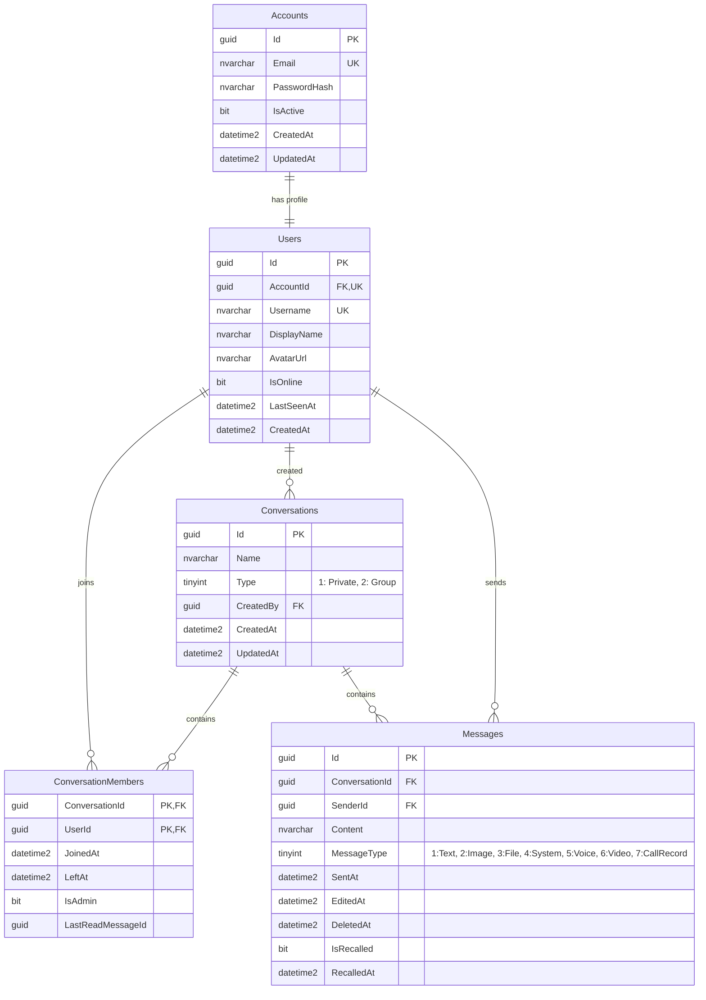

# 💬 MessageZ - Realtime Chat & WebRTC Communication Platform

<p align="center">
  
  
  
  
  
  
</p>

---

## 📖 1. Project Overview

**MessageZ** is a real-time messaging and communication platform (Real-time Chat & WebRTC Calling System). The project is engineered with a **Clean/Layered Architecture** paired with the **Repository & Unit of Work Pattern**, ensuring high scalability, enterprise-grade security, and optimal performance.

The platform enables users to participate in direct 1-on-1 chats, create and manage group chats, share rich multimedia messages (images, files, voice recordings, video clips), and conduct ultra-low-latency peer-to-peer voice and video calls via WebRTC, with SignalR Hub functioning as the signaling routing server.

---

## 🛠️ 2. Tech Stack

### Backend & Frameworks
- **Language & Runtime**: C# 12, [.NET 8](https://dotnet.microsoft.com/download/dotnet/8.0) (ASP.NET Core Web API).
- **ORM & Data Access**: [Entity Framework Core 8](https://learn.microsoft.com/ef/core/) (Code-First / DbContext mapping).
- **Database**: Microsoft SQL Server.
- **Real-time Messaging**: [ASP.NET Core SignalR](https://learn.microsoft.com/aspnet/core/signalr/introduction) (WebSocket, Server-Sent Events, Long Polling fallback).
- **Voice & Video Calling (P2P)**: [WebRTC](https://webrtc.org/) Signaling orchestrated via SignalR Hub.

### Security & Authentication
- **JSON Web Tokens (JWT)**: `Microsoft.AspNetCore.Authentication.JwtBearer` featuring dual-mode authentication (HTTP Authorization Header and Query String `access_token` for SignalR WebSocket connections).
- **Password Hashing**: `BCrypt.Net-Next` provides industry-standard, salted password hashing to protect against rainbow table attacks.
- **CORS**: Configured with full support for credential validation across origins (`AllowCredentials`).

### Media Storage & Optimization
- **Cloud Storage**: [Cloudinary](https://cloudinary.com/) (`CloudinaryDotNet 1.29.3`) for persistent cloud storage of avatars, chat images, attachments, voice notes, and videos.
- **Automated Cleanup**: Automatically purges obsolete media assets from Cloudinary upon avatar updates or message recalls.

### Libraries & Utilities
- **AutoMapper 16.2.0**: Automated object-to-object mapping between domain Entities and DTOs.
- **Swashbuckle.AspNetCore 6.6.2 (Swagger / OpenAPI)**: Interactive API documentation and testing environment.
- **Microsoft.AspNetCore.OData 9.2.1**: Flexible data querying and filtering support.

---

## 🚀 3. Key Features

### 3.1. Authentication & Account Management
- **Registration (`/api/auth/register`)**: Validates input constraints (unique Email & Username, password complexity), hashes passwords using BCrypt, and initializes user profile records.
- **Login (`/api/auth/login`)**: Verifies credentials, validates account active status (`IsActive`), and issues a signed JWT Bearer Token containing the User Identifier and session claims.

### 3.2. User Profile & Presence Management
- **User Profile**: View and update display name (`DisplayName`), email address, and account creation details.
- **Avatar**: Upload avatars to the Cloudinary `messagez/avatars` folder; automatically deletes the previous avatar from the cloud upon replacement.
- **User Discovery**: Search users by Username or Display Name to start conversations.
- **Online Presence Tracking**:
  - Real-time user connection and disconnection detection via SignalR (`InMemoryPresenceTracker`).
  - Broadcasts `UserPresenceChanged` events across active connections immediately.
  - Persists and tracks last active timestamps (`LastSeenAt`).

### 3.3. 1-on-1 & Group Chat
- **1-on-1 Chat (Direct Message)**:
  - Create or retrieve existing private chat rooms between two users.
  - Automatically resolves recipient details (display name, avatar) for conversation listings.
- **Group Chat Management**:
  - Create groups with initial member lists, automatically assigning the creator as Administrator (`IsAdmin = true`).
  - **Add Members**: Add multiple members simultaneously; supports reactivating former members who previously left.
  - **Remove Members**: Admin privilege to remove members from the group.
  - **Leave Group**: Members can voluntarily leave; if the sole Admin leaves, admin privileges are automatically reassigned to the earliest-joined remaining member.
  - **Rename Group**: Real-time group title updates accompanied by an automated system notification message.
- **Mark as Read**: Tracks the last read message (`LastReadMessageId`) and accurately calculates unread counts (`UnreadCount`) per member.

### 3.4. Rich Media Messaging
Messages are categorized via the `MessageType` discriminator:
1. **Text Message (Type 1)**: Instant text messaging via SignalR.
2. **Image (Type 2)**: Multipart/form-data upload hosted on Cloudinary, delivering image URLs and dimensions.
3. **Attachment / Document (Type 3)**: Document and archive uploads to Cloudinary stored with metadata (filename, file size, extension).
4. **System Message (Type 4)**: Automated audit trail logging group events (group created, member added, group renamed, member left).
5. **Voice Note (Type 5)**: Audio recording upload to Cloudinary with playback duration metadata.
6. **Short Video (Type 6)**: Short video messaging (up to 60 seconds) with automated Cloudinary video thumbnail generation.
7. **Call Record (Type 7)**: Voice/video call session logs (call type, status: Completed / Missed / Rejected, duration).

### 3.5. Smart Message Recall
- **Permissions**: Only the original message sender has the authority to recall a message.
- **Time Window**: Recalls are permitted within **5 hours** of sending.
- **Cloudinary Cleanup**: For media messages (images, files, voice notes, videos), physical assets are automatically purged from Cloudinary to free storage and protect user privacy.
- **Data Integrity**: Retains database record flagged with `IsRecalled = true`, `RecalledAt` timestamp, and masks the content to *"This message has been recalled"*.
- **Real-time Sync**: Dispatches the `MessageRecalled` event and updates last message previews for all conversation participants instantly.

### 3.6. Real-time Voice & Video Calling (WebRTC Signaling)
SignalR Hub (`ChatHub`) acts as a signaling broker enabling direct peer-to-peer (P2P) WebRTC connections:
- `CallUser`: Initiates a voice or video call and emits an `IncomingCall` event to the recipient with caller information.
- `AnswerCall`: Accepts or rejects incoming calls, notifying the caller via `CallAnswered`.
- `SendSignal`: Relays WebRTC session negotiation payloads (SDP Offers, Answers, ICE Candidates) via `ReceiveSignal`.
- `EndCall`: Terminates the session and broadcasts `CallEnded`.
- `RecordCall`: Synchronizes call status and duration as a persistent conversation message record.

---

## 📂 4. Project Structure

```text
MessageZ/
├── MessageZ/
│   ├── WebAPI/                             # ASP.NET Core Web API Backend
│   │   ├── Controllers/                    # API Endpoints
│   │   │   ├── AuthController.cs           # Authentication & Registration
│   │   │   ├── UserController.cs           # Profile, Avatar & User Search
│   │   │   └── ConversationController.cs   # Chat, Messages, Media & Group Management
│   │   ├── DTOs/                           # Data Transfer Objects
│   │   │   ├── Auth/                       # Auth DTOs (Register, Login)
│   │   │   ├── Conversation/               # Conversation, Member & Group DTOs
│   │   │   ├── Message/                    # Text, File, Voice & Video Message DTOs
│   │   │   └── User/                       # User Profile DTOs
│   │   ├── Hubs/                           # SignalR Hubs & Providers
│   │   │   ├── ChatHub.cs                  # Real-time Chat Hub & WebRTC Signaling
│   │   │   └── CustomUserIdProvider.cs     # Maps SignalR connections to UserId from JWT
│   │   ├── Models/                         # Database Entities & Context
│   │   │   ├── Account.cs                  # Account credentials entity
│   │   │   ├── User.cs                     # User profile entity
│   │   │   ├── Conversation.cs             # Conversation room entity
│   │   │   ├── ConversationMember.cs       # Member association & permissions entity
│   │   │   ├── Message.cs                  # Message & recall status entity
│   │   │   └── RealtimeChatDbContext.cs    # EF Core DbContext
│   │   ├── Repositories/                   # Data Access Layer
│   │   │   ├── IConversationRepository.cs
│   │   │   ├── IUserRepository.cs
│   │   │   ├── IAccountRepository.cs
│   │   │   ├── IUnitOfWork.cs
│   │   │   └── Implements/
│   │   ├── Services/                       # Business Logic Layer
│   │   │   ├── IAuthService.cs             # Authentication & JWT issuance
│   │   │   ├── IConversationService.cs     # Chat, messaging, recall & group services
│   │   │   ├── IPhotoService.cs            # Cloudinary avatar upload & deletion
│   │   │   ├── IFileService.cs             # Cloudinary attachments, voice & video
│   │   │   ├── IUserPresenceTracker.cs     # Online presence tracking service
│   │   │   └── Implements/
│   │   ├── Mappers/                        # AutoMapper Profiles
│   │   ├── appsettings.json                # Database, JWT & Cloudinary configurations
│   │   └── Program.cs                      # Dependency Injection, Middleware & Pipeline
│   │
│   ├── WebMVC/                             # Client Web UI (ASP.NET Core MVC Client)
│   └── MessageZ.sln                        # Visual Studio Solution File
│
├── db.sql                                  # SQL Server database initialization script
└── README.md                               # Project documentation
```

---

## 🗄️ 5. Database Schema

The **`RealtimeChatDb`** database consists of 5 core tables designed with foreign key constraints and optimized indexes:



---

## ⚡ 6. Getting Started

### Prerequisites
- [.NET 8 SDK](https://dotnet.microsoft.com/download/dotnet/8.0).
- [Microsoft SQL Server](https://www.microsoft.com/sql-server) (or SQL Server Express / Docker container).
- Free account on [Cloudinary](https://cloudinary.com/) for media API credentials.

### Step 1: Database Setup
1. Open SQL Server Management Studio (SSMS) or Azure Data Studio.
2. Open the [db.sql](file:///e:/MessageZ/db.sql) script located at the root of the project repository.
3. Execute the script to create the `RealtimeChatDb` database alongside all tables, primary keys, foreign keys, and indexes.

### Step 2: Configure `appsettings.json`
Open [appsettings.json](file:///e:/MessageZ/MessageZ/WebAPI/appsettings.json) in `MessageZ/WebAPI/` and configure your credentials:

```json
{
  "ConnectionStrings": {
    "DefaultConnection": "Server=YOUR_SERVER;Database=RealtimeChatDb;User Id=sa;Password=YOUR_PASSWORD;TrustServerCertificate=True;Encrypt=False;"
  },
  "Jwt": {
    "Key": "YourSuperSecretKeyWithLengthAtLeast32CharactersHere!",
    "Issuer": "MessageZ",
    "Audience": "MessageZ"
  },
  "Cloudinary": {
    "URL": "CLOUDINARY_URL=cloudinary://<API_KEY>:<API_SECRET>@<CLOUD_NAME>"
  }
}
```

### Step 3: Build and Run WebAPI
Open a terminal in the WebAPI project directory:

```bash
cd MessageZ/WebAPI
dotnet restore
dotnet build
dotnet run
```

Upon successful startup:
- **Swagger API Documentation**: `https://localhost:<port>/swagger`
- **SignalR Hub Endpoint**: `https://localhost:<port>/chatHub`

---

## 📡 7. API Endpoints Overview

| Module | Method | Endpoint | Description |
| :--- | :--- | :--- | :--- |
| **Auth** | `POST` | `/api/auth/register` | Register a new user account |
| | `POST` | `/api/auth/login` | Authenticate user and receive JWT Bearer Token |
| **User** | `GET` | `/api/user` | Search users (`?query=...`) |
| | `GET` | `/api/user/profile` | Get current user's profile |
| | `PUT` | `/api/user/profile` | Update display name |
| | `POST` | `/api/user/avatar` | Upload new avatar image |
| **Conversation** | `GET` | `/api/conversation` | Get conversation list with unread counts & latest preview |
| | `POST` | `/api/conversation/one-on-one` | Start or open a 1-on-1 direct conversation |
| | `POST` | `/api/conversation/group` | Create a new group chat |
| | `GET` | `/api/conversation/{id}/messages` | Retrieve conversation message history |
| | `GET` | `/api/conversation/{id}/members` | Get member list of a conversation |
| | `POST` | `/api/conversation/{id}/members` | Add new member(s) to group |
| | `DELETE`| `/api/conversation/{id}/members/{userId}` | Remove member from group (Admin only) |
| | `POST` | `/api/conversation/{id}/leave` | Leave group chat |
| | `PUT` | `/api/conversation/{id}` | Update group conversation name |
| | `POST` | `/api/conversation/{id}/read` | Mark messages in conversation as read |
| | `POST` | `/api/conversation/{id}/images` | Send an image message |
| | `POST` | `/api/conversation/{id}/files` | Send a file attachment message |
| | `POST` | `/api/conversation/{id}/voice` | Send a voice recording message (with duration) |
| | `POST` | `/api/conversation/{id}/video` | Send a short video clip (max 60 seconds) |
| | `POST` | `/api/conversation/{id}/messages/{messageId}/recall` | Recall message within 5 hours of sending |

---

## 📄 8. Notes
API keys and secrets provided in configuration templates are for local development purposes only and contain no personal value.